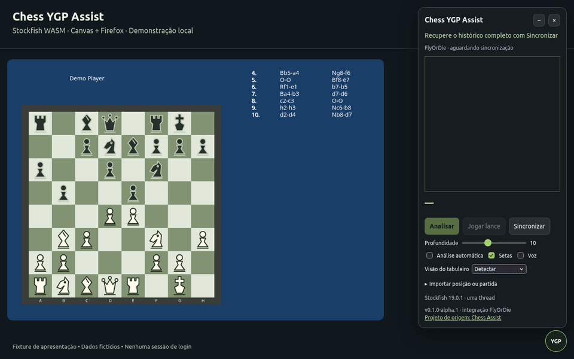
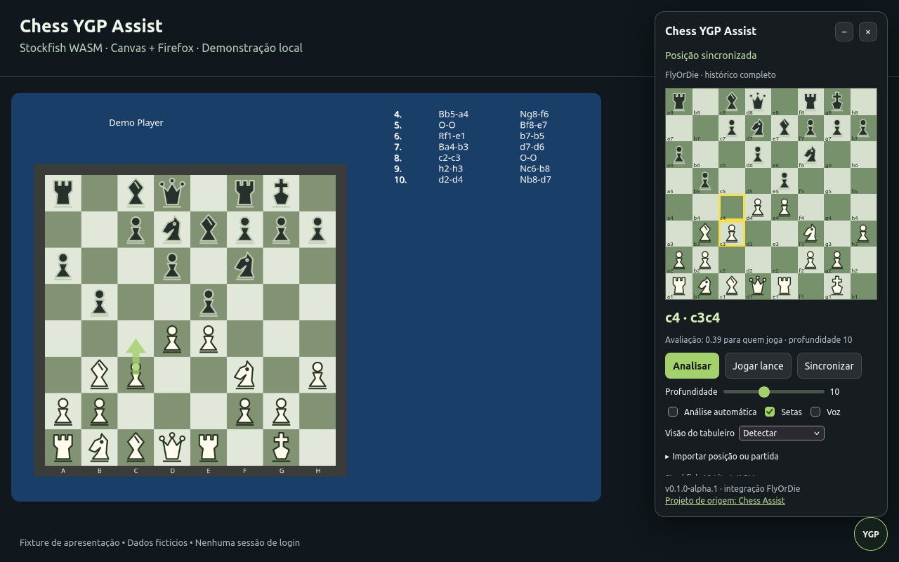
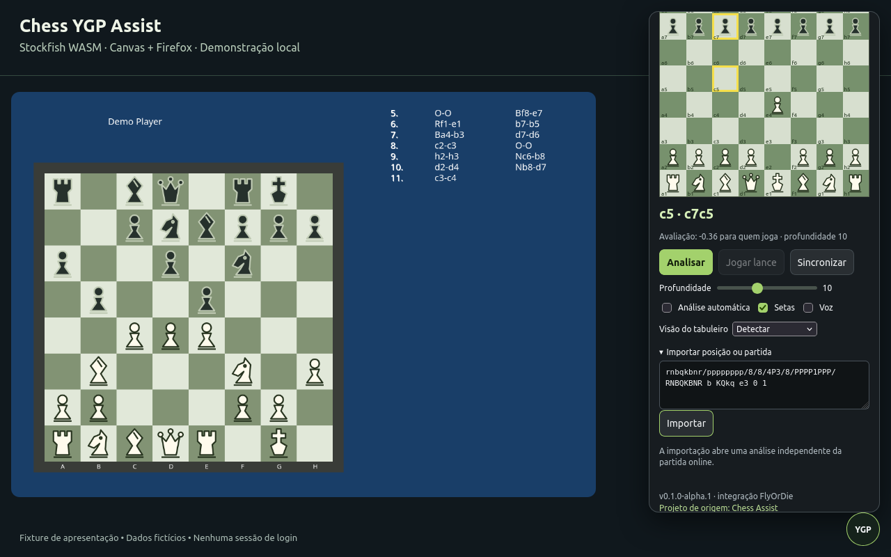

# Chess YGP Assist

> **Pré-alpha · v0.1.0-alpha.1** — primeira versão pública para testes; a integração ainda pode mudar.

**Stockfish WASM no FlyOrDie, com análise local e um painel integrado ao tabuleiro.**
Mini-tabuleiro, setas de melhor lance e controle pelo launcher Firefox, sem CDN para carregar o motor.


[](THIRD_PARTY_NOTICES.md)

## Veja em ação



Demonstração em fixture local que reproduz o canvas do FlyOrDie, com dados fictícios e o motor real. O painel exibe a avaliação numérica e a profundidade alcançada.

| Painel e melhor lance | Sincronização | Análise FEN/PGN |
|---|---|---|
|  |  |  |

[Ver captura completa do tabuleiro e painel](.github/screenshot-gameplay.png)

## Funcionalidades

- **Stockfish 19.0.1 WASM offline** — motor Lite de uma thread incorporado ao build; a análise não usa CDN. Instalar dependências e acessar o FlyOrDie requer internet.
- **Leitura do canvas** — acompanha o histórico desenhado pelo jogo e sincroniza automaticamente a abertura. Em partidas longas, **Sincronizar** percorre a lista e recupera os lances desde o início.
- **Setas de melhor lance** — sugestão sobre o tabuleiro, acompanhada de mini-tabuleiro, avaliação e profundidade.
- **Narração por voz** — anuncia a sugestão usando as vozes disponíveis no navegador.
- **Análise livre por FEN/PGN** — estude uma posição ou partida sem depender da sessão online.
- **Execução assistida** — **Jogar lance** envia o movimento escolhido por clique, após conferir posição, orientação, vez e legalidade.
- **Perfil persistente no launcher Firefox** — mantém o login entre sessões em um perfil separado do navegador habitual.

## Requisitos e início rápido

Node.js 24.22.3 ou patch posterior da série 24, npm 12.2.2–12.x e uma sessão gráfica para abrir o launcher Firefox. Use o nvm para selecionar a versão do projeto.

```sh
git clone https://github.com/yurigarciapardinho/chess-ygp-assist.git
cd chess-ygp-assist
nvm use
npm ci
npm run build
npm run browser
```

Na primeira execução, o launcher Firefox pode precisar baixar o navegador compatível.

1. Faça login no FlyOrDie e abra uma partida ou uma observação.
2. Deixe **Visão do tabuleiro → Detectar**. Se necessário, selecione a cor que aparece embaixo.
3. A abertura é lida automaticamente. Se entrou com a partida em andamento, clique em **Sincronizar** e aguarde a recuperação do histórico. O painel se recolhe durante a rolagem e volta ao terminar.
4. Use **Analisar** ou mantenha **Análise automática** ligada. **Profundidade** define o alvo da busca: valores maiores podem levar mais tempo.
5. Para outra posição, abra **Importar posição ou partida**, cole uma FEN completa ou PGN e clique em **Importar**. **Sincronizar** retorna à partida online.

O botão **YGP** recolhe ou reabre o painel. As preferências de profundidade, orientação, setas e voz são salvas no navegador. Após atualizar o projeto, reabra o launcher para carregar o código novo nas próximas janelas.

## Limitações e escopo

- Funciona com **xadrez padrão no FlyOrDie**, incluindo os modos de velocidade Rapid, Blitz e Bullet. Freestyle/Chess960 e Pawn7 ficam fora do escopo.
- Precisa do **histórico completo** para reconstruir roque, en passant e contadores. A posição das peças sozinha não fornece essas informações.
- O fluxo integrado de captura antecipada do canvas, recuperação do histórico e clique usa o **launcher Firefox**. A distribuição userscript também permite análise independente com FEN/PGN.
- A execução é por lance confirmado; não há auto-play contínuo. Promoções são escolhidas manualmente no cliente.
- A interface é responsiva; os testes atuais usam navegador desktop. Mudanças no renderizador do FlyOrDie podem exigir ajustes no adaptador.

## Projeto e documentação

```text
src/
  adapters/   Leitura do cliente e do canvas
  core/       Posição, sessão e geometria
  engine/     Stockfish e integridade dos assets
  ui/         Painel, mini-tabuleiro e setas
  entries/    Inicialização
tools/        Build, launcher, testes e captura de mídia
tests/        Testes e fixtures
.github/      GIF e screenshots
docs/         Documentação técnica
dist/         Distribuições geradas
```

- [Arquitetura, desenvolvimento e testes](docs/ARCHITECTURE.md)
- [Segurança, privacidade e dependências](docs/SECURITY.md)
- [Origem e licenças dos componentes](THIRD_PARTY_NOTICES.md)

Baseado no [Chess Assist, de ThatKidGlitchy](https://github.com/ThatKidGlitchy/chess-hacks), com adaptação para FlyOrDie/launcher Firefox. O motor deriva de [Stockfish.js](https://github.com/nmrugg/stockfish.js) e [Stockfish](https://github.com/official-stockfish/Stockfish).
